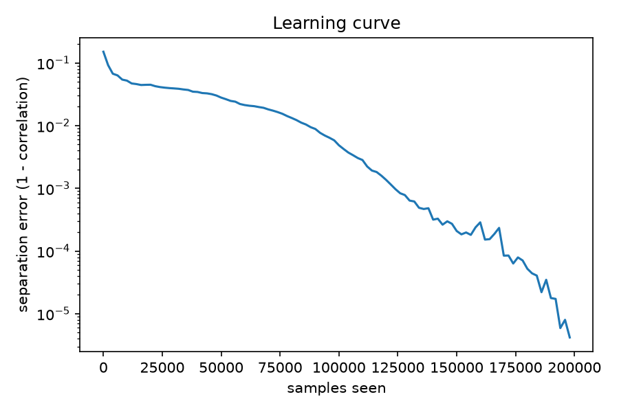

# EGHR ICA reproduction

A small reproduction of the error-gated Hebbian rule (EGHR) from:

> Isomura, T. & Toyoizumi, T. "A local learning rule for independent
> component analysis." *Scientific Reports* 6, 28073 (2016).
> https://doi.org/10.1038/srep28073

This is an independent student reproduction. All ideas and the learning
rule belong to the original authors; the code in this repository is my own.

A two-neuron network learns to separate two mixed Laplace sources
using only the local rule in equation 1 of the paper.

## Run

    uv run eghr.py

## Result

The absolute correlation between each source and each output:

    [[1.    0.001]
     [0.004 1.   ]]

Each source is recovered by exactly one output.

## Figures

Sources, mixed inputs and recovered outputs. Each output matches one
source up to a sign flip, which the paper counts as a valid solution:

Network outputs before and after learning:

Separation error during learning:

To regenerate the figures:

    uv run plots.py

## Status

Done:
- Reproduction of equation 1 for two Laplace sources
- Plots of signals, outputs and the learning curve

Planned:
- Comparison with a standard ICA method (FastICA)
- Tests with more sources and different mixing matrices

## Author

Md Shamin Yasir Ovi, Peter the Great St. Petersburg Polytechnic University