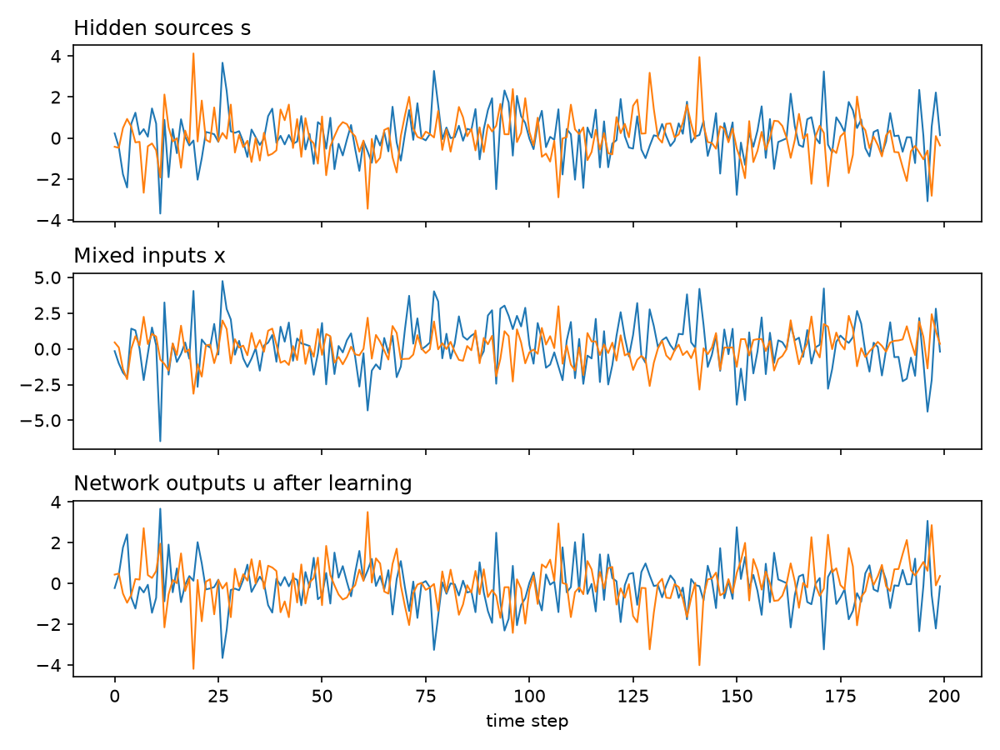
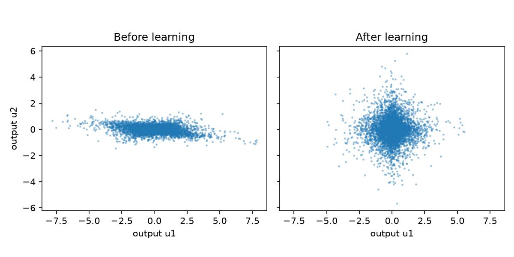
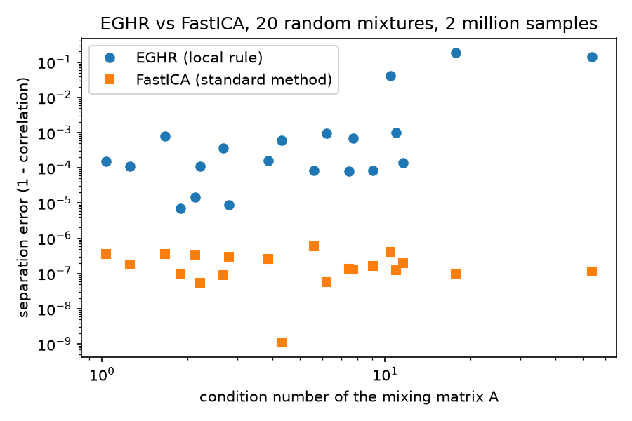

# EGHR ICA reproduction

A small reproduction of the error-gated Hebbian rule (EGHR) from:

> Isomura, T. & Toyoizumi, T. "A local learning rule for independent
> component analysis." *Scientific Reports* 6, 28073 (2016).
> https://doi.org/10.1038/srep28073

This is an independent student reproduction. All ideas and the learning
rule belong to the original authors; the code in this repository is my own.

A two-neuron network learns to separate two mixed Laplace sources
using only the local rule in equation 1 of the paper.

## Run

    uv run eghr.py

## Result

The absolute correlation between each source and each output:

    [[1.    0.001]
     [0.004 1.   ]]

Each source is recovered by exactly one output.

## Figures

Sources, mixed inputs and recovered outputs. Each output matches one
source up to a sign flip, which the paper counts as a valid solution:

Network outputs before and after learning:

Separation error during learning:

Comparison with FastICA over 20 random mixing matrices (2 million samples
each). FastICA is more accurate in every trial. The local rule reaches an
error below 0.01 in 17 of 20 trials; the three remaining trials are among
the worst-conditioned mixtures and had not converged yet:

To regenerate the figures:

    uv run plots.py
    uv run compare.py

## Status

Done:
- Reproduction of equation 1 for two Laplace sources
- Plots of signals, outputs and the learning curve
- Comparison with a standard ICA method (FastICA)

Planned:
- How learning time depends on the condition number of the mixing matrix
- Tests with more than two sources

## Author

Md Shamin Yasir Ovi, Peter the Great St. Petersburg Polytechnic University